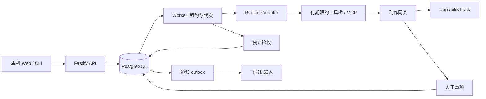

# 架构与持久执行

GoalLoop 是模块化单体。Web 和 CLI 共用 Fastify API，API 与 Worker 可以独立进程启动；PostgreSQL 是业务状态唯一事实来源。React 只负责呈现，执行器只负责当前轮次，任何执行器都不能直接将目标标记完成。

## 业务模型

| 数据                                   | 作用                                                       |
| -------------------------------------- | ---------------------------------------------------------- |
| goals / goal_versions                  | 目标当前状态与不可变契约版本；范围、策略和验收绑定同一版本 |
| tasks                                  | 子任务、依赖、连续未推进次数与等待状态                     |
| jobs                                   | 数据库队列、持久定时、租约、owner 与递增 epoch             |
| runs                                   | 每轮执行器、会话引用、实际用量、错误分类与令牌哈希         |
| human_tasks                            | 澄清、单次审批、能力请求、外部协作与人工验收               |
| actions / resource_locks               | 具体参数、前置条件、授权、派发、结果与互斥资源             |
| evidence                               | 独立观测、版本、采样时间、到期时间及缺失标记               |
| events                                 | 单调游标的事件流；SSE 用 Last-Event-ID 续接                |
| outbox                                 | 与业务事务一起提交的通知任务及重试状态                     |
| simulator_nodes / simulator_operations | 与 Agent 文本分离的模拟环境与幂等操作回执                  |

新目标是 `draft`；用户检查范围、策略和验收方式后显式启动。首版从所选能力包形成契约，不自动把自然语言解释成强制授权。能力包无法消除的关键歧义可以通过 `request_human` 转为澄清。目标修改保留历史版本并使旧审批失效；执行器切换必须等待轮次结束，或者先暂停。

目标状态：`draft → active → succeeded / expired / cancelled`；`active` 也可进入 `paused / blocked` 并显式恢复。子任务独立处于 `ready / running / waiting_human / waiting_event / done`。有依赖的任务必须等待前置任务全部完成；单个任务等待不会阻塞其他资源。`failed` 为保留的终止状态，默认执行失败采用有界重试后求助。

## 认领、恢复和终止

1. Worker 在事务中用 `FOR UPDATE SKIP LOCKED` 认领到期任务，增加 epoch，写入 owner 与 lease_until。
2. 一轮的运行令牌以哈希存储，绑定 run、task、goal version 和 job epoch。每次工具调用检查状态、版本、代次、租约及目标期限。
3. 心跳只能延长仍有效的同一代租约。失去租约的 Worker 被中断，不能恢复旧授权。
4. 服务启动及循环扫描过期租约、可运行任务和遗漏验收任务；业务状态恢复不依赖进程内计时器或即时通知。
5. 暂停、取消和策略变更递增/撤销队列代次，关闭本轮执行。已经派发的动作仍保留并核对结果。
6. 人工等待不保留 Agent 进程。独立验收仍可定期采样，期间不调用模型。回答及外部事件在事务中写入唤醒任务；重复回复/事件不重复派发。

单轮默认 10 分钟，目标默认 7 天，同一任务连续无进展最多 3 次。默认总轮数 100；可配置上限。模型实际返回用量才入账，不支持用量的执行器保留 NULL。Token 预算在轮次之间执行，无法阻止某轮请求本身越过剩余数量；单轮期限、模型输出上限和总轮数共同约束消耗。

## 动作协议

Markdown 是指导文字，结构化 policy 是强制边界。匹配优先级 `deny > approval_required > allow`，未匹配默认拒绝。能力的参数 schema、读写属性、执行和核对函数由安装的能力包定义，不能由模型声明。

写动作状态：`prepared → authorized → dispatched → confirmed`。派发后发生断连进入 `outcome_unknown`，保持资源锁。审批绑定参数摘要、资源前置条件、目标/策略版本及有效期；执行前全部重新检查。参数变更产生另一条提案。

外部系统不受数据库事务包裹，**不宣称任意外部动作 exactly-once**。模拟环境使用 action ID 幂等回执；工作区使用文件内容哈希核对。不能证明结果时请求人工核对，确认未生效后也不会盲目重复旧提案。操作者应调整方案/契约，再授权新的动作。生产能力包必须自己实现服务端幂等键、资源版本比较和可信回执。

## 独立验收与维持型报告

- `candidate` 只是候选。验收器重新读取外部状态；Agent 声明完成、人回复“修好了”、模型退出成功均不能代替观测。
- 集群范围在创建时冻结。缺机器、遥测 stale 或过期都不合格；不能靠删除低分机器提高平均分。评分阈值修改生成新版本并清空稳定期。
- achieve 必须连续稳定且无未决派发动作才成功；采样间隔超出证据有效期会重置稳定期。
- maintain 达标后继续采样，退化后重新开放治理任务。到期状态为 `expired`，报告提供健康/违规/缺失毫秒数、覆盖率和时间区间，区间带对应契约版本，不将最后一次达标视为全周期合格。
- 工作区示例的源文件在隔离副本中。QuickJS 没有主机文件/网络接口，限制内存、栈和执行时间；输入、期望输出及断言在宿主中，任务代码无法修改测试逻辑。

## 本机边界

默认只监听 127.0.0.1，Host/Origin 严格校验。浏览器写请求需要本次启动生成的控制令牌，跨站网页无法读取；服务重启后客户端自动重新获取。运行令牌仅可调用当前轮次的 MCP 工具，不可审批、启动/取消目标或访问控制数据库。

这是一套**单用户、受信任主机**应用，不是对本机恶意进程或恶意管理员的隔离沙箱。管理员安装的 CapabilityPack/SDK 属于信任边界。模型原生 shell、写文件、外部 MCP 与子代理入口在适配器中关闭/过滤。不要将本机 API 直接发布公网。

容器仅在容器内绑定 0.0.0.0，Compose 将宿主端口发布到 127.0.0.1。Docker 文件是交付模板，是否在当前机器验证见 validation 文档。

## Plugin、Skill、Hook 的位置

后台和 PostgreSQL 承担持久生命周期。Plugin 可以分发能力包、配置模板和使用指导；Skill 可以指导 Agent 使用 GoalLoop MCP；Hook 可以把运行时请求转成工具桥或人工事项。它们不会替代租约、队列、动作核对和独立验收。首版提供 MCP 接口和能力包加载入口，不自动安装插件，也不允许 Agent 扩权。
